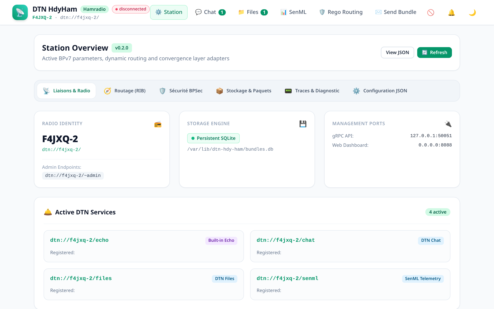
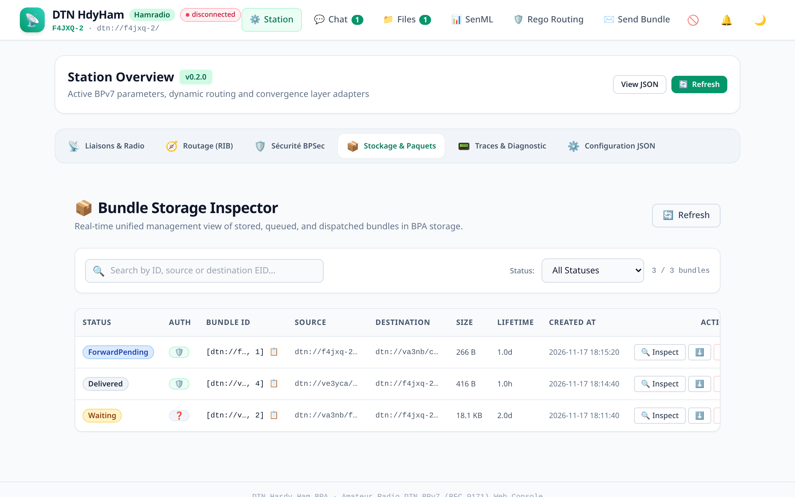
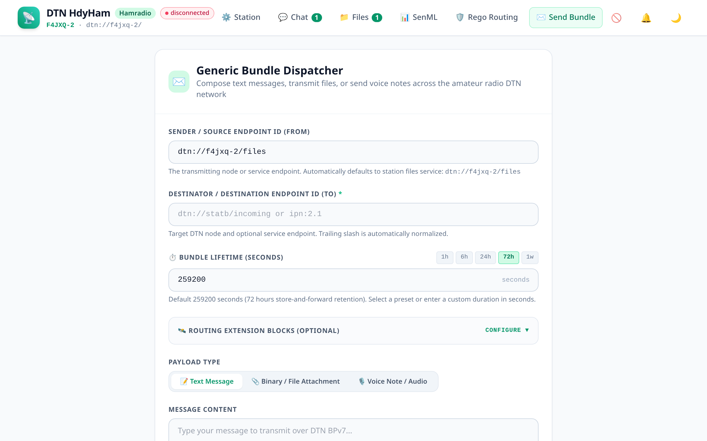

# dtnpm-web-core

Core Axum WebUI server, plugin registry (`WebModule`), capabilities discovery API, system routes, and Preact WebUI shell for **DTN Postmaster** (`dtnpm`).

## Screenshots

| Station Overview | Bundle Storage Inspector |
| :---: | :---: |
|  |  |

| Send Bundle |
| :---: |
|  |

## Architecture

`dtnpm-web-core` decouples the core HTTP/SSE console from optional application plugins:

- **`WebModule` trait & `ModuleContext`**: Shared plugin interface with SQLite schema migrations (`migrate(&Connection)`), BPA service registration (`register_bpa(&ModuleContext)`), and Axum sub-routers.
- **Capabilities Discovery**: `GET /api/capabilities` and `GET /api/v1/capabilities` advertise installed module descriptors (`id`, `name`, `version`, `base_path`, `services`).
- **System API (`/api/v1/...`)**: Endpoints for `config`, `services`, `events` (SSE), `logs`, `bundles`, `clas`, `routes`, and `security`.
- **Module Mounting**: Each `WebModule` mounts strictly under `/api/<module>/v1/...`.
- **Frontend Shell (`ui/`)**: Preact + Vite application querying `/api/capabilities` at startup and dynamically displaying enabled tabs; prebuilt static assets live in `ui/dist/`.
- **Test Harness (`test_harness`)**: `TestServerBuilder` for isolated module and router integration testing.

## Build and Test

Requires sibling checkouts of `../dtnpm-core` and `../../hardy/*` as referenced in `Cargo.toml`.

```bash
cargo test
```

## Security & Compliance

- **Cyber Resilience Act (CRA)**: Secure default sessions (`HttpOnly`, `SameSite=Lax`), VEX audit documentation (`RUSTSEC-2026-0459`), and SHA-pinned CI actions.
- **OWASP Web & API Protection**: Exact URI host CORS enforcement, CSRF origin/`Sec-Fetch-Site` checks, bounded rate limiting (4,096 entries), safe content delivery (`attachment` for SVG, RFC 5987 headers), and bounded `ffmpeg` remuxing (2 permits, 10s timeout, 16 MiB output cap, `kill_on_drop`).
- **Rust Quality Standards**: Zero-unwrap and zero-panic rule in production (`-D clippy::unwrap_used -D clippy::panic`).
- **Documentation**: See [`AGENTS.md`](AGENTS.md), [`docs/CONTRIBUTING.md`](docs/CONTRIBUTING.md), [`SECURITY.md`](SECURITY.md), and Architectural Decision Records in [`adr/`](adr/).

## License

Dual-licensed under the Apache License, Version 2.0 or the MIT License. See [LICENSE.md](LICENSE.md).
